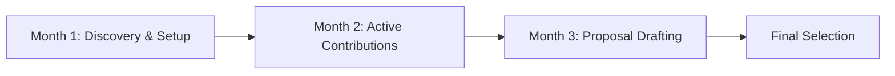

# 🚀 Paid Open-Source Fellowships & Grants Directory (2026 Edition)

> A definitive, zero-fluff directory of paid global open-source fellowships, student grants, remote internships, and stipends. Everything you need to go from your first pull request to getting funded.

---

## 📌 Table of Contents
1. [Master Comparison Matrix](#-master-comparison-matrix)
2. [Deep-Dive Program Breakdowns](#-deep-dive-program-breakdowns)
   - [Google Summer of Code (GSoC)](#1-google-summer-of-code-gsoc)
   - [LFX Mentorship (Linux Foundation)](#2-lfx-mentorship-linux-foundation)
   - [MLH Fellowship](#3-mlh-fellowship)
   - [Outreachy](#4-outreachy)
   - [GitHub Octernships](#5-github-octernships)
   - [Summer of Bitcoin](#6-summer-of-bitcoin)
   - [Season of KDE (SoK)](#7-season-of-kde-sok)
3. [The 90-Day Winning Roadmap](#-the-90-day-winning-roadmap)
4. [The Anatomy of a Winning Proposal](#-the-anatomy-of-a-winning-proposal)
5. [Communication Etiquette (Slack / IRC / Mailing Lists)](#-communication-etiquette)
6. [Contributing](#-contributing)

---

## 📊 Master Comparison Matrix

| Program | Organization / Host | Stipend (USD / Local) | Duration | Application Window | Key Tech Stacks |
| :--- | :--- | :--- | :--- | :--- | :--- |
| **[GSoC](#1-google-summer-of-code-gsoc)** | Google Open Source | **\$750 – \$3,000 USD** (PPP-adjusted) | 12 to 22 weeks | Feb – March (Annual) | Python, C++, Rust, Go, JS/TS, AI/ML |
| **[LFX Mentorship](#2-lfx-mentorship-linux-foundation)** | Linux Foundation | **\$1,300 – \$6,600 USD** (PPP-based) | 12 weeks | 3 Cohorts: Jan, May, Aug | Go, C, Rust, Kubernetes, Cloud Native |
| **[MLH Fellowship](#3-mlh-fellowship)** | Major League Hacking | **\$2,000 – \$4,000 USD** | 12 weeks | Spring, Summer, Fall | Python, JavaScript/Node, Web, DevOps |
| **[Outreachy](#4-outreachy)** | Software Freedom Conservancy | **\$7,000 USD** + \$500 travel | 13 weeks | Jan & Aug (2 Cohorts/yr) | Python, Rust, Documentation, UX/UI, Web |
| **[GitHub Octernships](#5-github-octernships)** | GitHub Education | **\$500 – \$2,500/mo** (varies by partner) | 1 to 6 months | Rolling / Year-round | Full-Stack, AI, DevOps, Mobile |
| **[Summer of Bitcoin](#6-summer-of-bitcoin)** | Summer of Bitcoin Foundation | **\$2,000 – \$3,000 USD** (in BTC) | 12 weeks | Feb – March (Annual) | C++, Rust, Bitcoin Core, Lightning |
| **[Season of KDE](#7-season-of-kde-sok)** | KDE Community | Swag / Certs + Community Grant | 12 weeks | Dec – Jan (Annual) | C++, Qt, QML, Linux Systems |

---

## 🔍 Deep-Dive Program Breakdowns

### 1. Google Summer of Code (GSoC)
* **Official Portal:** [summerofcode.withgoogle.com](https://summerofcode.withgoogle.com/)
* **Eligibility:** Open to students and open-source beginners (18+ years old).
* **Stipend Structure (India Example):**
  * Small Projects (~90 hrs): **\$750 USD**
  * Medium Projects (~175 hrs): **\$1,500 USD**
  * Large Projects (~350 hrs): **\$3,000 USD**
  * *Disbursement:* 45% post-midterm evaluation, 55% post-final evaluation via Payoneer.
* **Top Participating Organizations:** TensorFlow, Python Software Foundation (PSF), Apache Software Foundation, GNU, KDE, Red Hat, Blender, CERN.
* **Key Secret:** Do not wait for the student application period. Reach out in **December/January** as soon as the mentor organizations list is announced.

---

### 2. LFX Mentorship (Linux Foundation)
* **Official Portal:** [mentorship.lfx.linuxfoundation.org](https://mentorship.lfx.linuxfoundation.org/)
* **Eligibility:** Developers worldwide (students and non-students).
* **Stipend:** Baseline calculated via Linux Foundation PPP index (e.g., \$1,300 USD for India baseline; up to \$6,600 in high-cost regions).
* **Terms:**
  * **Spring Term:** March – May (Apps open in January)
  * **Summer Term:** June – August (Apps open in April)
  * **Fall Term:** September – November (Apps open in July)
* **Top Projects:** CNCF (Kubernetes, Prometheus, Envoy), Hyperledger, OpenSSF, Linux Kernel.
* **Key Secret:** LFX mentors screen applicants heavily based on **pre-existing pull requests**. If you haven't opened at least 1-2 merged PRs in the target repo before applying, your chances are low.

---

### 3. MLH Fellowship
* **Official Portal:** [fellowship.mlh.io](https://fellowship.mlh.io/)
* **Tracks:**
  * **Open Source Track:** Work directly on major repos (e.g., Meta's Jest, AWS tools, ClickHouse).
  * **Software Engineering Track:** Build production projects with corporate partner teams.
* **Stipend:** Needs-based educational stipend ranging from \$2,000 to \$4,000 USD depending on location and financial need.
* **Selection Process:** Written essay application → Technical interview (walking through code you wrote) → Behavioral interview.

---

### 4. Outreachy
* **Official Portal:** [outreachy.org](https://www.outreachy.org/)
* **Eligibility:** Dedicated to providing opportunities for individuals subject to systemic bias and impacted by underrepresentation in the technical industry.
* **Stipend:** **\$7,000 USD** total stipend + \$500 travel stipend.
* **Unique Feature:** Requires a mandatory **Contribution Period** where all applicants publicly submit PRs to project repositories. Your final acceptance depends on your contributions during this 4-week window.

---

### 5. GitHub Octernships
* **Official Portal:** [education.github.com/octernships](https://education.github.com/students/octernships)
* **Eligibility:** Verified GitHub Global Campus students with a valid student email.
* **Structure:** Paid remote internships with verified tech companies across the globe. Projects are submitted as real-world code assignments reviewed by company engineering leads.

---

### 6. Summer of Bitcoin
* **Official Portal:** [summerofbitcoin.org](https://www.summerofbitcoin.org/)
* **Eligibility:** University students globally.
* **Stipend:** **\$2,000 – \$3,000 USD equivalent**, paid in Bitcoin (BTC).
* **Focus Areas:** Bitcoin Core, Lightning Network protocols, Bitcoin UI/UX, Rust-Bitcoin libraries.
* **Selection Process:** Online screening test (DSA + Bitcoin fundamentals) followed by a proposal submission.

---

## 🗺 The 90-Day Winning Roadmap

### Month 1: Discovery & Setup (60–90 Days Before Deadline)
1. **Pick 2 Organizations Max:** Do not spray and pray across 10 repos. Pick two organizations matching your exact stack (e.g., Python + FastAPI or Go + Cloud Native).
2. **Build from Source:** Clone the repository, follow the contribution guidelines (`CONTRIBUTING.md`), and build the project locally on your machine.
3. **Join Communication Channels:** Join their official Slack, Discord, or Zulip workspace. Introduce yourself in the `#introductions` or `#newcomers` channel (keep it short and humble).

### Month 2: Active Contributions (30–60 Days Before Deadline)
1. **Target Good First Issues:** Search GitHub issues labeled `good first issue`, `documentation`, or `bug`.
2. **Submit 2–3 Clean Pull Requests:** Focus on fixing a real broken test, correcting documentation errors, or adding a missing unit test.
3. **Ask High-Signal Questions:** Never ask *"How do I start?"*. Ask: *"I reproduced issue #142 locally. It looks like the timeout in `client.py` line 45 isn't propagating. May I open a PR with this fix?"*

### Month 3: Proposal Drafting & Review (Last 30 Days)
1. **Choose a Listed Project Idea:** Pick an idea from the official Ideas List, or propose an original project after discussing it with mentors.
2. **Share an Early Draft:** Never submit your proposal on deadline day without mentor feedback. Share a Google Doc with comment access 2–3 weeks before the deadline.
3. **Incorporate Feedback:** Refine your timeline, add architectural flowcharts, and verify milestone feasibility.

---

## 📝 The Anatomy of a Winning Proposal

Every successful proposal includes these 6 non-negotiable sections (see full template in [`templates/proposal-template.md`](templates/proposal-template.md)):

1. **Executive Summary:** A 3-sentence summary of what problem you are solving, the proposed architecture, and the deliverable.
2. **Current State vs. Proposed State:** Code diagrams showing how the system functions now and what it looks like after your implementation.
3. **Weekly Milestone Breakdown:**
   * *Weeks 1–4:* Foundations, interfaces, unit tests.
   * *Weeks 5–8:* Core implementation, integration tests, midterm evaluation.
   * *Weeks 9–11:* Edge-case handling, documentation, benchmarks.
   * *Week 12:* Polishing, final review, and merge.
4. **Link to Merged Pull Requests:** Direct proof of your existing merged code in their repository.
5. **Contingency Plan:** What you will do if a dependency fails or an API changes.
6. **Time Commitment & Bio:** Explicit statement guaranteeing 30–40 hours/week with zero conflicting commitments.

---

## 💬 Communication Etiquette

### ❌ What NOT to do:
* Don't tag `@channel` or `@here` with generic messages like *"Can someone guide me?"*
* Don't direct message (DM) maintainers asking for projects unless explicitly invited to do so.
* Don't post *"I want to contribute"* under an issue without explaining what you plan to do.

### ✅ What gets you noticed:
* **The "I already investigated" rule:** State what you tried, what failed, and the specific link to the line of code you're questioning.
* **Public communication:** Keep technical discussions in public channels so other contributors can learn from the answer.
* **Review other PRs:** Politely testing another contributor's PR and confirming it works on your OS is one of the fastest ways to gain maintainer trust.

---

## 🤝 Contributing

Found a program that belongs here? Or did a stipend policy change?
1. Fork this repository.
2. Update the table or add a program in Markdown.
3. Submit a Pull Request.

---

## 📄 License
This guide is licensed under the [MIT License](LICENSE).
