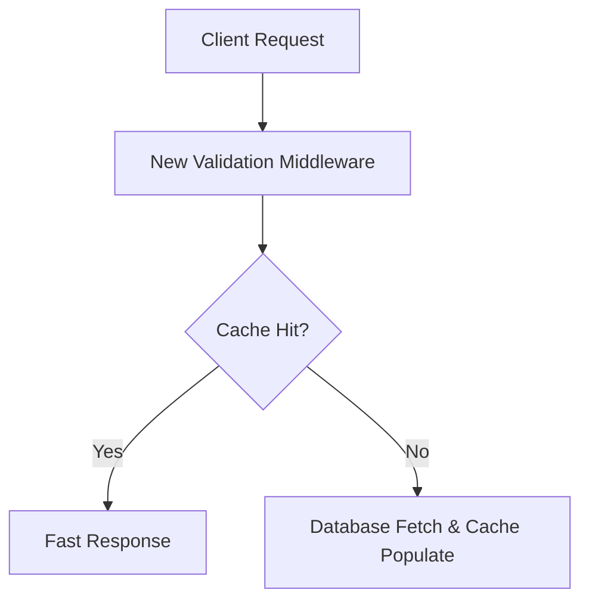

# [Project Title]: [Sub-title / Short Description]

* **Candidate Name:** [Your Full Name]
* **Email:** [Your Email]
* **GitHub Profile:** [Link to your GitHub]
* **LinkedIn / Portfolio:** [Optional Link]
* **Target Organization:** [e.g., CNCF / Python Software Foundation]
* **Mentors:** [Mentor Names if known]
* **Project Size:** [Small (~90h) / Medium (~175h) / Large (~350h)]

---

## 1. Executive Summary
Provide a concise 3–4 sentence summary answering:
* What is the current problem or missing feature in the project?
* How do you propose to solve it?
* What is the tangible deliverable at the end of the program?

---

## 2. Technical Architecture & Approach

### 2.1 Current State Analysis
Explain how the codebase handles this problem today. Reference exact files and function names:
* File: `src/core/engine.py` (Line 120)
* Limitation: Explain why the current approach is slow, incomplete, or lacks functionality.

### 2.2 Proposed Solution & Architecture
Detail your technical approach. Include a system flowchart or class diagram:

### 2.3 Key Technical Components
* **Component 1 (API Design):** Detail routes, parameters, and expected response payloads.
* **Component 2 (Data Layer):** Schema updates, migrations, or cache layer additions.
* **Component 3 (Error Handling):** How exceptions and network failures are handled safely.

---

## 3. Milestones & Weekly Timeline

### Pre-Coding Period (Community Bonding)
* Review documentation and finalize interfaces with mentors.
* Set up local benchmarking harnesses.
* Break down weekly tasks into individual GitHub issues.

### Phase 1: Foundations (Weeks 1 – 4)
* **Week 1:** Set up base interfaces, configuration classes, and initial test suite.
* **Week 2:** Implement the first core sub-module with unit test coverage (>85%).
* **Week 3:** Connect the sub-module to existing pipelines and test backward compatibility.
* **Week 4:** Buffer week for mentor review and PR revision.

### Midterm Evaluation Deliverable
* [ ] Working end-to-end prototype of the first core component.
* [ ] Full unit test suite passing in CI.

### Phase 2: Core Implementation & Integration (Weeks 5 – 8)
* **Week 5:** Implement second major module.
* **Week 6:** Integrate with existing database / network layer.
* **Week 7:** Add end-to-end integration tests.
* **Week 8:** Refactor based on mentor midterm feedback.

### Phase 3: Benchmarking, Documentation & Polish (Weeks 9 – 12)
* **Week 9:** Performance profiling (CPU, memory, latency benchmarks).
* **Week 10:** Comprehensive documentation: tutorials, API reference, docstrings.
* **Week 11:** Edge case handling and fuzz testing.
* **Week 12:** Final review, addressing PR comments, merging into main branch.

---

## 4. Prior Open Source Contributions
Demonstrate proof of prior competence in this organization or related projects:

* **PR #1 (Merged):** [Link to PR] — Fixed memory leak in parser.
* **PR #2 (Merged):** [Link to PR] — Added missing unit test coverage for router.
* **Issue #3 (Opened):** [Link to Issue] — Identified and documented race condition under concurrent load.

---

## 5. Contingency Plan & Risk Management
* **Risk 1:** Upstream dependency breaks or has breaking API changes.
  * *Mitigation:* Pin dependency versions in virtual environment; implement adapter pattern to decouple core logic.
* **Risk 2:** Time estimate for Milestone 2 runs over schedule.
  * *Mitigation:* Built-in buffer week at Week 4 and Week 8 to absorb unexpected debugging delays without missing milestones.

---

## 6. Time Commitment & Availability
* **Weekly Hours:** 35–40 hours/week dedicated exclusively to this project.
* **Other Commitments:** No conflicting internships, jobs, or exam schedules during the coding period.
* **Working Hours:** Available for daily updates and sync meetings between [Timezone, e.g., 10:00 AM – 6:00 PM IST].
